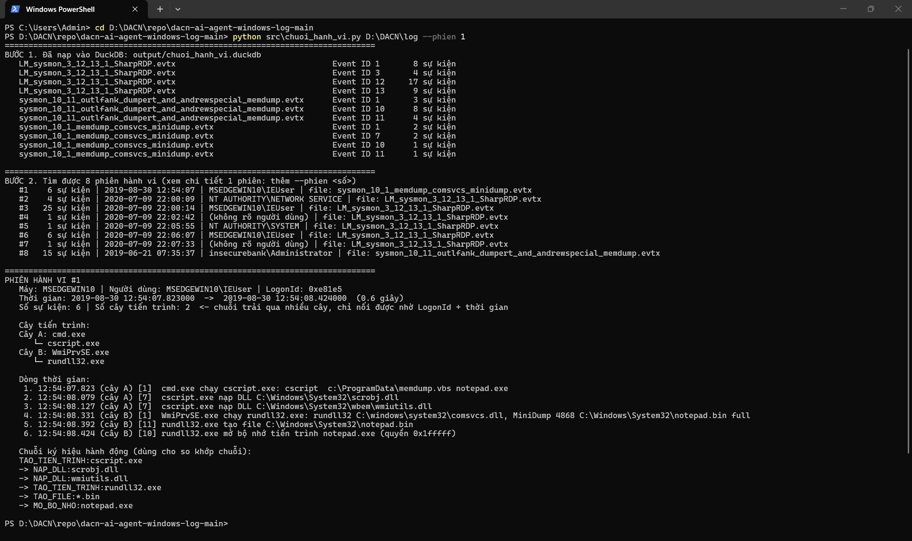
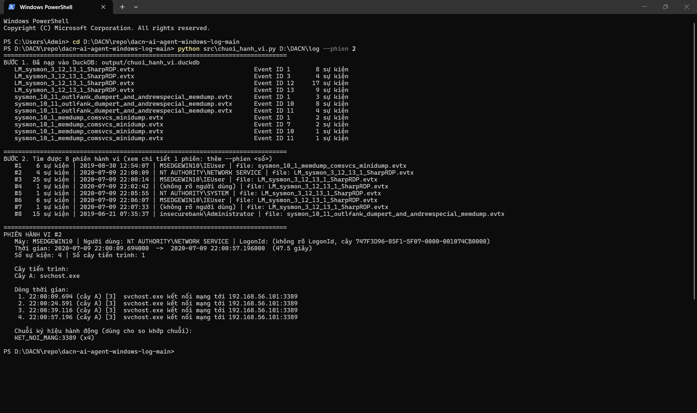
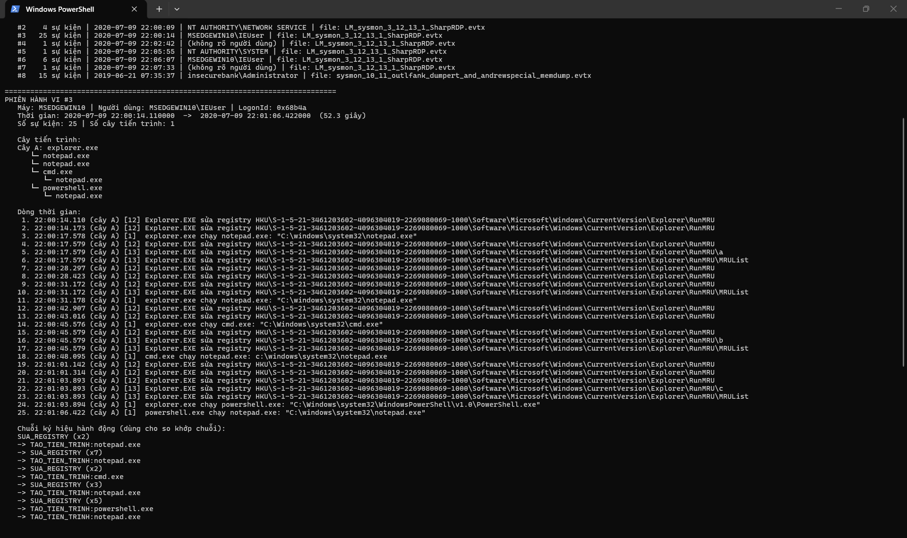
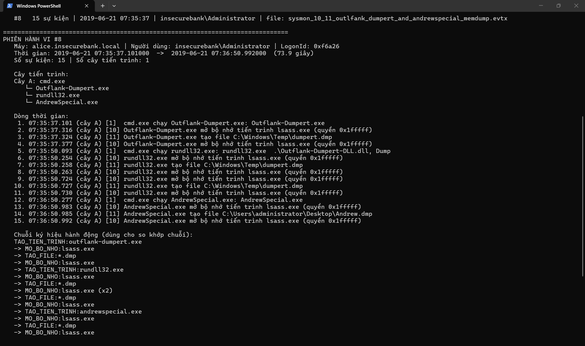

# Phương pháp phát hiện hành vi tấn công

Bản nháp tuần 2 (cập nhật 24/10/2026 theo số đếm lại theo nội dung của Thiên). Người soạn: Khôi. Thiên và Dũng đọc, góp ý trước buổi báo cáo 24/10.

## Tóm tắt 3 ý (mỗi thành viên phải tự nói lại được)

1. **Hành vi là gì?** Là một chuỗi hành động có thứ tự, trên cùng một máy, cùng một phiên đăng nhập (tài khoản) hoặc cùng một cây tiến trình, xảy ra trong một khoảng thời gian ngắn. Một dòng log Sysmon chỉ là một hành động lẻ. Chuỗi hành động mới là hành vi.
2. **Phương pháp gì?** Gom log thành chuỗi hành động, rút gọn chuỗi thành ký hiệu, so khớp với các chuỗi tấn công đã gán nhãn để phát hiện sớm từ vài sự kiện đầu và dự đoán bước tiếp theo, sau đó kiểm chứng bằng dấu vết bắt buộc trước khi kết luận.
3. **Làm bao nhiêu kỹ thuật, vì sao?** Hai tầng. Tầng rộng nhận diện 144 kỹ thuật Windows có log Sysmon/PowerShell trong Splunk Attack Data, nhưng chỉ báo độ chính xác chính thức cho 79 kỹ thuật có từ 3 file trở lên (đếm theo nội dung file), vì cần dữ liệu riêng để kiểm tra. Tầng sâu là 8 kỹ thuật tạo thành một chuỗi tấn công hoàn chỉnh, được kiểm chứng kỹ bằng dấu vết và demo đầy đủ.

---

## 1. Định nghĩa hành vi

**Sự kiện (hành động lẻ):** một dòng log, ví dụ Sysmon Event ID 1 "cmd.exe chạy rundll32.exe", Event ID 10 "rundll32.exe mở bộ nhớ lsass.exe".

**Hành vi:** một chuỗi sự kiện thỏa đồng thời:

| Điều kiện | Cách xác định trong log |
|---|---|
| Cùng máy | Trường `Computer` |
| Cùng phiên đăng nhập | Trường `LogonId` (có ở Event ID 1; các sự kiện khác lấy theo tiến trình gây ra) |
| Hoặc cùng cây tiến trình | `ProcessGuid` và `ParentProcessGuid` |
| Có thứ tự, sát nhau về thời gian | Hai sự kiện liên tiếp cách nhau không quá 300 giây (giá trị tạm, sẽ thử nghiệm) |

Log Sysmon là **đối tượng** quan sát. Hành vi là **chuỗi** hành động rút ra từ log.

**Vì sao không chỉ dùng cây tiến trình:** kẻ tấn công có thể nhờ một dịch vụ khác chạy hộ lệnh, làm đứt quan hệ cha-con. Ví dụ ở phiên #1 phần 6: script VBS gọi WMI, nên lệnh dump bộ nhớ lại là con của `WmiPrvSE.exe` chứ không phải con của script. Chỉ khi dùng thêm `LogonId` và thời gian mới nối được hai nửa thành một hành vi.

## 2. Phương pháp 5 bước

```
Log Sysmon / PowerShell (.evtx, sau này thêm Security)
   │
   ▼
[1] Chuẩn hóa      → bảng su_kien trong DuckDB (cột chung cho mọi loại sự kiện)
   │
   ▼
[2] Gom phiên      → mỗi phiên = 1 ứng viên hành vi (máy + LogonId/cây tiến trình + thời gian)
   │
   ▼
[3] Rút gọn        → chuỗi ký hiệu hành động, vd TAO_TIEN_TRINH:rundll32.exe → MO_BO_NHO:lsass.exe → TAO_FILE:*.dmp
   │
   ▼
[4] So khớp + dự đoán → sau mỗi sự kiện mới: phiên này giống kỹ thuật nào? bước tiếp theo có thể là gì?
   │
   ▼
[5] Kiểm chứng dấu vết → chỉ kết luận khi có đủ dấu vết bắt buộc của kỹ thuật
```

### Bước 1. Chuẩn hóa log

Đọc file .evtx và đưa mọi sự kiện về một bảng chung `su_kien` gồm: thời gian, Event ID, máy, tiến trình thực hiện (GUID, tên file), tiến trình cha, dòng lệnh, người dùng, LogonId, đối tượng bị tác động (tiến trình đích, file, DLL, khóa registry, địa chỉ mạng) và quyền truy cập.

Trạng thái: **đã làm** (`src/chuoi_hanh_vi.py`, đọc EVTX). Đọc log XML của Splunk Attack Data dời sang tuần 3.

### Bước 2. Gom phiên hành vi

- Dựng cây cha-con từ Event ID 1.
- Gắn `LogonId` cho mọi sự kiện: lấy từ Event ID 1 của chính tiến trình đó, nếu không có thì lấy theo cả cây (khi mọi tiến trình trong cây cùng một LogonId).
- Gom theo máy + LogonId, tách phiên khi hai sự kiện liên tiếp cách nhau quá 300 giây.

Trạng thái: **đã làm**, chạy thử trên 3 file EVTX-ATTACK-SAMPLES (phần 6).

### Bước 3. Rút gọn thành chuỗi ký hiệu

Mỗi sự kiện được đổi thành một ký hiệu, bỏ các chi tiết thay đổi giữa các lần tấn công (PID, GUID, đường dẫn cụ thể, tên file dump) và giữ lại loại hành động cùng đối tượng:

| Event ID | Ký hiệu | Ví dụ |
|---|---|---|
| 1 | `TAO_TIEN_TRINH:<tên exe>` | `TAO_TIEN_TRINH:rundll32.exe` |
| 3 | `KET_NOI_MANG:<cổng>` | `KET_NOI_MANG:3389` |
| 7 | `NAP_DLL:<tên dll>` | `NAP_DLL:wmiutils.dll` |
| 10 | `MO_BO_NHO:<tiến trình đích>` | `MO_BO_NHO:lsass.exe` |
| 11 | `TAO_FILE:*<đuôi file>` | `TAO_FILE:*.dmp` |
| 12, 13, 14 | `SUA_REGISTRY` | (sẽ tách theo loại khóa, xem phần 7) |
| 4104 | `CHAY_SCRIPT_POWERSHELL` | |

Các bước lặp liên tiếp được gộp lại (vd `MO_BO_NHO:lsass.exe (x2)`).

**Không dùng trường `RuleName`** của Sysmon. Đây là nhãn do người viết cấu hình đặt (vd "CredAccess - Memdump"). Dùng nó để nhận diện chẳng khác gì nhìn đáp án.

Mức rút gọn là một quyết định quan trọng: rút gọn quá thì mất thông tin (hai hành động khác nhau thành cùng ký hiệu), chi tiết quá thì hai lần tấn công giống nhau lại không khớp được.

Trạng thái: **đã làm bản đầu**, cần chỉnh (phần 7).

### Bước 4. So khớp chuỗi và dự đoán bước tiếp theo (dự kiến tuần 3–5)

Học từ dữ liệu có nhãn: mỗi file log tấn công trong Splunk Attack Data / EVTX-ATTACK-SAMPLES được gán nhãn theo mã kỹ thuật (tên thư mục). Chạy bước 1–3 trên các file này để có các **chuỗi mẫu** cho từng kỹ thuật.

Khi một phiên mới chạy, sau **mỗi** sự kiện mới:

- **So khớp:** so phần chuỗi đã thấy với các chuỗi mẫu, chấm điểm giống nhau cho từng kỹ thuật. Vượt ngưỡng thì cảnh báo sớm, không cần chờ hết phiên.
- **Dự đoán bước tiếp theo:** đếm trong dữ liệu có nhãn "sau ký hiệu A thường là ký hiệu gì". Ví dụ: sau `MO_BO_NHO:lsass.exe` thường là `TAO_FILE:*.dmp`.

Cách làm cơ sở (làm trước): đếm tần suất các cặp/bộ ba ký hiệu liên tiếp. Sau đó mới thử cách phức tạp hơn nếu cách cơ sở chưa đủ tốt.

**Vai trò mô hình ngôn ngữ nhỏ (đề xuất, cần cả nhóm chốt):** bước 4 thu hẹp xuống vài kỹ thuật ứng viên, rồi mô hình chọn trong danh sách đó và giải thích bằng dòng log làm bằng chứng. Lý do chọn cách này: khi thử nghiệm tháng 10, các mô hình đoán sai mã kỹ thuật khi tự nhớ, nhưng chọn đúng khi được đưa danh sách ứng viên. Khi đáp án đúng không có trong danh sách, mô hình vẫn chọn bừa và bịa lý do. Vì vậy cần bước 5.

### Bước 5. Kiểm chứng bằng dấu vết bắt buộc

Mỗi kỹ thuật tầng sâu có danh sách dấu vết phải có. Agent chỉ kết luận khi tìm thấy dấu vết trong log, nếu thiếu thì ghi "chưa xác nhận" thay vì đoán. Đây cũng là cách agent tự phát hiện lỗi của chính nó (kể cả lỗi bịa lý do của mô hình) mà không cần người kiểm tra.

Bản nháp danh sách dấu vết (Thiên, Dũng kiểm tra lại trên log thật):

| Mã | Dấu vết bắt buộc (ít nhất một) |
|---|---|
| T1105 | Tiến trình tải file (certutil, bitsadmin, PowerShell Invoke-WebRequest/DownloadFile) + kết nối mạng (Sysmon 3) + tạo file (Sysmon 11) |
| T1059.001 | Sysmon 1 chạy powershell.exe với tham số đáng ngờ (`-enc`, `-w hidden`, `-nop`) hoặc nội dung script trong PowerShell 4104 |
| T1053.005 | Sysmon 1 `schtasks /create`, hoặc file mới trong `C:\Windows\System32\Tasks` (Sysmon 11), hoặc Security 4698 |
| T1547.001 | Sysmon 13 ghi vào khóa `...\CurrentVersion\Run` / `RunOnce`, hoặc file mới trong thư mục Startup |
| T1136.001 | Security 4720 (tạo tài khoản), hoặc dòng lệnh `net user ... /add` / `New-LocalUser` |
| T1003.001 | Sysmon 10 có tiến trình đích là `lsass.exe` với quyền đọc bộ nhớ, kèm tạo file dump |
| T1021.001 | Security 4624 logon type 10, hoặc Sysmon 3 cổng 3389 phía máy đích (Initiated=false) |
| T1070.001 | Security 1102 hoặc System 104 (log bị xóa), hoặc lệnh `wevtutil cl` / `Clear-EventLog` |

Ví dụ thật: phiên #1 ở phần 6 dùng đúng cách dump của T1003.001 (comsvcs.dll MiniDump), nhưng tiến trình bị dump là `notepad.exe`. Dấu vết "đích là lsass.exe" không có, nên bước 5 **không xác nhận** T1003.001. Kết luận này đúng.

## 3. Phạm vi: hai tầng

Số liệu do Thiên đếm lại theo **nội dung** file ngày 24/10/2026 (chi tiết và bảng đầy đủ: `data/do-phu.md`).

| Tầng | Số kỹ thuật | Làm gì | Báo cáo kết quả |
|---|---|---|---|
| Rộng | 144 kỹ thuật Windows có log Sysmon/PowerShell trong Splunk Attack Data | Nhận diện (bước 1–4) | 79 kỹ thuật có ≥3 file: độ chính xác **chính thức**. 29 kỹ thuật có 2 file: **sơ bộ**. 33 kỹ thuật có 1 file và 3 kỹ thuật chưa tìm thấy file phù hợp: ghi rõ **chưa đo được** |
| Sâu | 8 kỹ thuật (bảng dưới) | Nhận diện + kiểm chứng dấu vết (bước 5) + demo chuỗi tấn công hoàn chỉnh | Đầy đủ cả 4 chỉ số ở phần 4 |

### Con số 144 đến từ đâu và vì sao đổi so với 161 / 71

- Danh sách ban đầu có 161 kỹ thuật. Gộp mã theo ATT&CK v20.0 còn 160 (xem `docs/attack-version.md`). Bỏ 16 kỹ thuật mà ATT&CK không ghi nền tảng Windows (đề tài là log Windows) còn **144**.
- Danh sách ban đầu đếm số file theo **tên** đường dẫn: chỉ tính file có chữ "sysmon" hoặc "powershell" trong đường dẫn, tính cả file mô tả `.yml`. Nhóm tự kiểm tra lại và thấy cách này **đếm thiếu**. Ví dụ file `atomic_red_team.log` chứa log Sysmon nhưng không có chữ "sysmon" trong tên.
- Cách đếm mới: đọc tối đa 8 MB đầu của mỗi file dữ liệu (bỏ `.yml`, `.md`, `.zip`; tổng 2.090 file, không lỗi). File được tính nếu có sự kiện Sysmon hoặc PowerShell 4104.

| Cách đếm (cùng 144 kỹ thuật) | ≥3 file | 2 file | 1 file | 0 file |
|---|---|---|---|---|
| Theo tên đường dẫn (cũ) | 68 | 31 | 45 | 0 |
| Theo nội dung (mới) | **79** | **29** | **33** | **3** |

Hạn chế của cách đếm mới (nói rõ khi báo cáo):

1. "Có sự kiện Sysmon hoặc 4104" chưa chứng minh file thể hiện đúng hành vi của kỹ thuật.
2. Chỉ đọc 8 MB đầu nên có thể còn đếm thiếu với file lớn.
3. 3 kỹ thuật ra 0 file (T1021.004, T1115, T1489) chưa kiểm tra nguyên nhân.
4. Còn 65 kỹ thuật Windows **ngoài** danh sách 161 cũng có file chứa Sysmon hoặc 4104 theo nội dung. Phạm vi tầng rộng có thể mở rộng thêm, sẽ xem xét ở tuần sau.

### Vì sao không phải "tất cả kỹ thuật"

Chỉ đo được độ chính xác cho kỹ thuật nào có log tấn công đã gán nhãn. Kỹ thuật không có dữ liệu thì không có gì để học, cũng không có gì để kiểm tra. 144 là số kỹ thuật Windows trong danh sách hiện tại có log Sysmon/PowerShell trong bộ dữ liệu lớn nhất nhóm tìm được (Splunk Attack Data).

### Vì sao mốc 3 file

Muốn đo độ chính xác công bằng thì phải thử trên file mà phương pháp **chưa thấy khi học**. Nhóm chia theo file, không chia theo sự kiện, để các sự kiện của cùng một lần tấn công không lọt vào cả hai bên.

- **≥3 file:** học trên 2 file, thử trên file còn lại, xoay vòng. Kết quả đáng tin hơn → báo chính thức.
- **2 file:** học 1, thử 1. Chỉ một lần thử → báo sơ bộ.
- **1 file:** không có file nào để thử → vẫn nhận diện nhưng không báo độ chính xác.

### Vì sao 8 kỹ thuật tầng sâu

- Ghép thành **một chuỗi tấn công hoàn chỉnh**: tải công cụ (T1105) → chạy PowerShell (T1059.001) → cài tự khởi động (T1053.005, T1547.001) → tạo tài khoản (T1136.001) → đánh cắp mật khẩu (T1003.001) → di chuyển sang máy khác (T1021.001) → xóa dấu vết (T1070.001).
- Thể hiện được Sysmon/PowerShell, là nguồn log chính của nhóm. Nhóm 3 dùng Security log, nên hai nhóm khác nhau về nguồn log và phương pháp.
- Tầng rộng giúp chuỗi **không bị đứt** khi kẻ tấn công dùng kỹ thuật nằm ngoài 8 kỹ thuật này.

Theo cách đếm cũ, T1021.001 (1 file) và T1070.001 (2 file) chưa đủ 3 file. Kiểm tra theo nội dung, T1021.001 có 9 file chứa log Sysmon và T1070.001 có 3 file, nên cả hai đã đủ ngay trong Splunk. EVTX-ATTACK-SAMPLES và OTRF dùng để bổ sung thêm, không còn bắt buộc.

## 4. Cách đo kết quả

| Chỉ số | Định nghĩa | Đo trên |
|---|---|---|
| Tỷ lệ phát hiện đúng | Số phiên tấn công được gán đúng mã kỹ thuật / tổng số phiên tấn công | File log tấn công không dùng khi học |
| Báo nhầm | Số cảnh báo trên log bình thường (tính theo ngày máy và theo 1.000 phiên) | Log bình thường thu trên máy 3 thành viên từ 17/10/2026 |
| Độ sớm | Phát hiện sau bao nhiêu sự kiện (và bao nhiêu giây) tính từ đầu phiên | Các phiên được phát hiện đúng |
| Dự đoán bước tiếp theo | Tỷ lệ ký hiệu dự đoán trùng ký hiệu xảy ra thực tế (đúng ở lựa chọn đầu tiên / nằm trong 3 lựa chọn đầu) | File log tấn công không dùng khi học |

Ví dụ độ sớm trên dữ liệu thật: ở phiên #8 (phần 6), sự kiện thứ 2 đã là "mở bộ nhớ lsass.exe với quyền 0x1fffff", tức đủ nghi sau **2 sự kiện**, khoảng 0,2 giây sau khi công cụ được chạy.

## 5. Dữ liệu

| Loại | Nguồn | Ghi chú |
|---|---|---|
| Log tấn công có nhãn | Splunk Attack Data (chính), EVTX-ATTACK-SAMPLES, OTRF | Chi tiết trong `data/datasets.md`, `data/do-phu.md` |
| Log bình thường | Máy Khôi, Thiên, Dũng, Sysmon cấu hình chung + Script Block Logging, thu từ 17/10/2026 | Không đưa log lên GitHub |

## 6. Kết quả chạy thử tuần 2

Chạy `src/chuoi_hanh_vi.py` trên 3 file EVTX-ATTACK-SAMPLES: comsvcs MiniDump, Dumpert + AndrewSpecial (T1003.001), và SharpRDP (T1021.001). Kết quả gom được 8 phiên. Lệnh xem từng phiên:

```powershell
python src\chuoi_hanh_vi.py D:\DACN\log --phien 1
```

**Phiên #1: chuỗi đi qua 2 cây tiến trình, nối được nhờ LogonId.**
`cscript.exe` chạy `memdump.vbs` (cây A: cmd.exe). Script nhờ WMI chạy `rundll32 comsvcs.dll MiniDump` (cây B: WmiPrvSE.exe). Hai cây cùng LogonId `0xe81e5`, cách nhau 0,6 giây. Tiến trình bị dump là notepad.exe, nên bước 5 không xác nhận T1003.001.



**Phiên #2: giới hạn của Sysmon.**
4 kết nối RDP cổng 3389 do `svchost.exe` (dịch vụ Remote Desktop, tài khoản NETWORK SERVICE) xử lý. Sysmon không cho biết kết nối này tạo ra phiên đăng nhập nào, nên không nối được vào phiên #3 dù xảy ra cùng lúc. Cần Security 4624 logon type 10 (cho biết LogonId và IP nguồn) để nối. Kết luận: Sysmon và Security log bổ sung cho nhau (chi tiết trong `docs/sysmon-vs-windows.md`).



**Phiên #3: SharpRDP, 25 sự kiện gộp đúng vào 1 phiên.**
Kẻ tấn công gõ lệnh vào hộp Win+R qua RDP. Explorer ghi vào khóa `RunMRU` (`a`, `b`, `c`) rồi mở notepad, cmd, powershell. Nhịp "sửa registry → tạo tiến trình" lặp lại 4 lần. Đây là ví dụ cho dự đoán bước tiếp theo.



**Phiên #8: ba công cụ khác tên, cùng một mẫu hành động.**
Một cmd.exe chạy lần lượt Outflank-Dumpert.exe, Outflank-Dumpert-DLL.dll (qua rundll32) và AndrewSpecial.exe trong 74 giây. Tên khác nhau nhưng chuỗi ký hiệu đều là `MO_BO_NHO:lsass.exe → TAO_FILE:*.dmp`. Vì vậy nhóm so khớp theo hành động chứ không theo tên công cụ.



## 7. Hạn chế hiện tại và việc tuần sau

| Hạn chế | Hướng xử lý |
|---|---|
| `SUA_REGISTRY` quá thô: ghi RunMRU (lịch sử Win+R) và ghi khóa Run (T1547.001) cùng một ký hiệu | Tách ký hiệu theo loại khóa (Run/RunOnce, Services, RunMRU, khác) |
| Chưa đọc Security log nên chưa nối được kết nối RDP vào phiên đăng nhập | Thêm Security 4624, 4688, 4720, 1102 vào bước 1 |
| Chưa đọc log XML của Splunk Attack Data | Tuần 3 |
| Các file thử đều ngắn, mỗi file một kỹ thuật, chưa có chuỗi nhiều kỹ thuật | Ghép chuỗi tấn công đầy đủ cho phần demo tầng sâu |
| Ngưỡng 300 giây chọn tạm | Thử nhiều ngưỡng, so sánh số phiên bị cắt/gộp sai |
| Bước 4 chưa làm | Bắt đầu bằng cách đếm cặp/bộ ba ký hiệu liên tiếp |
| Đếm độ phủ mới chỉ kiểm tra "có Sysmon/4104", chưa kiểm tra file có đúng hành vi của kỹ thuật | Khi đọc log Splunk ở tuần 3, kiểm tra thêm từng file thuộc 8 kỹ thuật tầng sâu |
| 65 kỹ thuật Windows ngoài danh sách 161 cũng có dữ liệu | Xem xét đưa vào tầng rộng |
